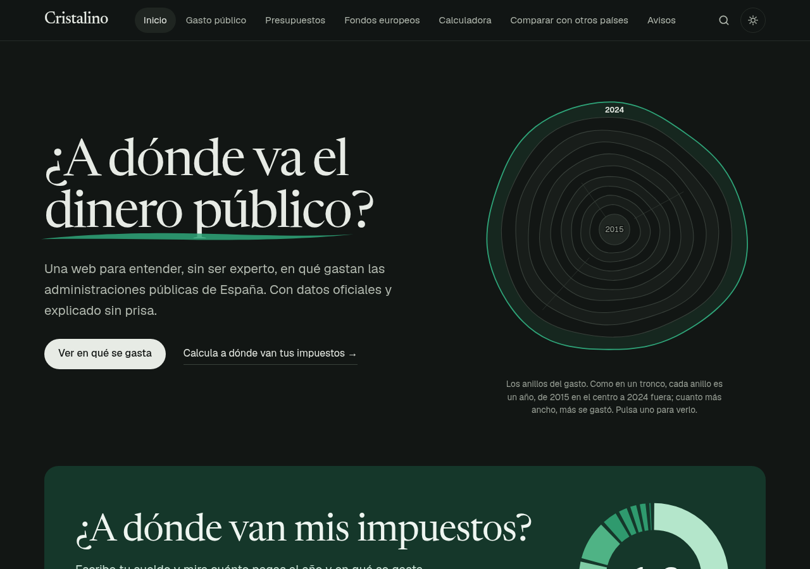
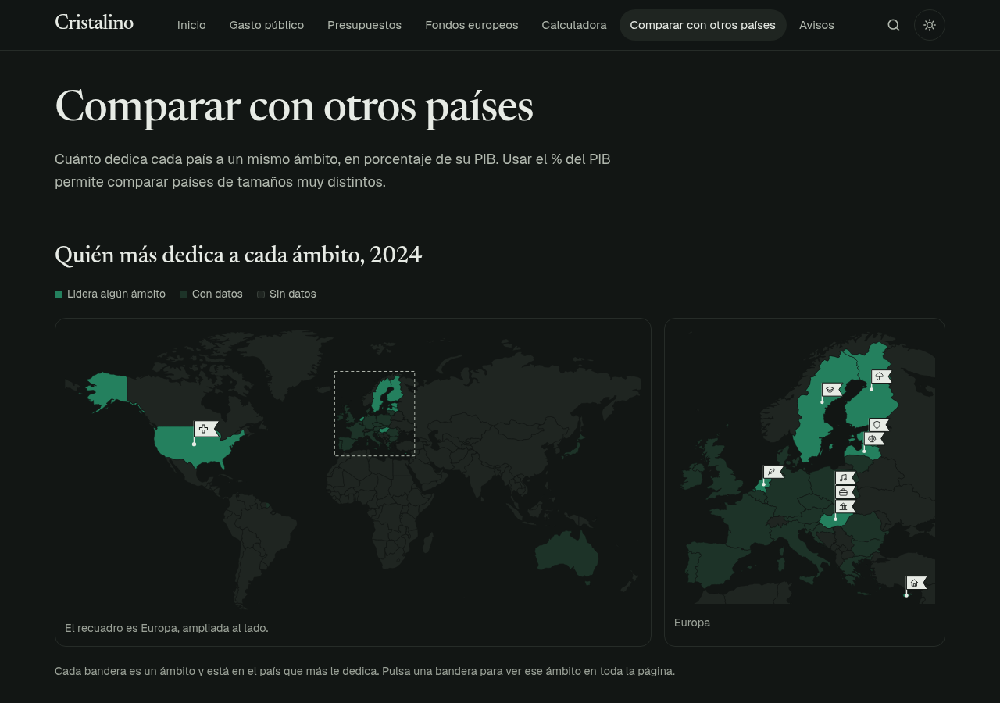
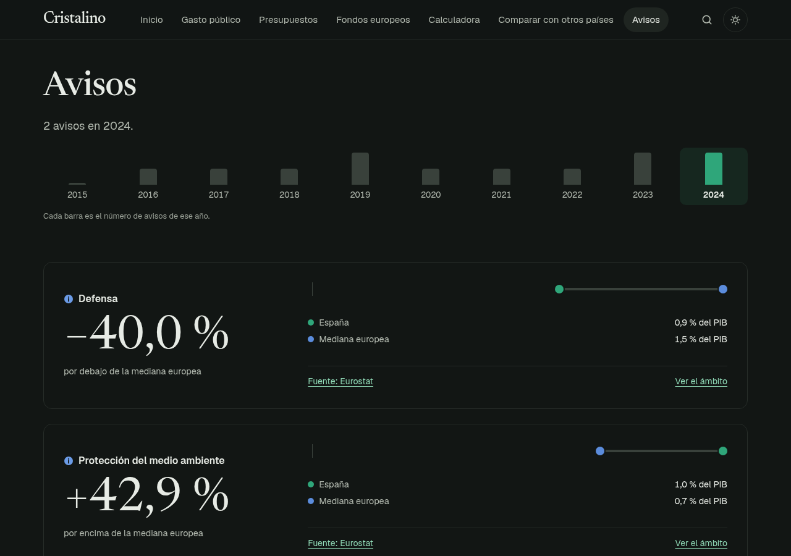

# Cristalino

*Como el agua.*

**¿A dónde va el dinero público?** Cristalino es una web para entender, sin ser experto,
en qué gastan las administraciones públicas de España. Todo sale de datos oficiales y
abiertos, y cada cifra enlaza a su fuente.

La hemos hecho Mario, Pedro y Dersu, el equipo **Leather and Lies**, en el hackatón
2Campus1Code de noviembre de 2026. Empezó llamándose CuentasClaras. A mitad de camino le
cambiamos el nombre por Cristalino, porque queríamos que las cuentas públicas se vieran
así, hasta el fondo.



## Por qué la hicimos

Los presupuestos son públicos, pero están repartidos en tablas que casi nadie abre. A
nosotros también nos costaba contestar a preguntas tan simples como cuánto se gasta en
sanidad o qué parte de la nómina acaba en pensiones. Por eso la portada son preguntas, las
mismas que nos hacíamos, y cada una lleva a una página que la contesta con cifras
oficiales.

El dibujo de la portada son los anillos del gasto. Como en un tronco, cada anillo es un
año, de 2015 en el centro a 2024 fuera, y cuanto más ancho, más se gastó.

## Qué puedes hacer

- **Gasto público.** Cuánto se gasta en cada ámbito (sanidad, educación, defensa…) de 2015
  a 2024, con su evolución, sus subámbitos y en qué se va el dinero (personal, compras,
  inversión…).
- **Calculadora.** Escribes tu sueldo y ves cuánto pagas al año en IRPF, cotización social
  e IVA, y cómo se reparte entre los ámbitos.
- **Presupuestos.** Los Presupuestos Generales del Estado de 2015 a 2025, partida a
  partida, con un diagrama de flujo que se puede recorrer con el ratón.
- **Fondos europeos** y **pensiones**, cada uno en su página.
- **Comparar con otros países.** Un mapa con el país que más dedica a cada ámbito y la
  posición de España entre los 27 de la UE, en % del PIB. Fuera de Europa están EE. UU.,
  Japón, Reino Unido, Corea del Sur y Australia.
- **Avisos.** Ámbitos en los que España se aleja de la mediana europea, o en los que el
  gasto no se corresponde con el uso real. Dicen dónde mirar y no acusan a nadie.
- **Buscador.** La lupa de la cabecera busca entre las partidas del presupuesto.

Los datos provisionales van marcados, y hay modo claro y modo oscuro.

| Ficha de un ámbito | Comparar con otros países | Avisos |
|---|---|---|
|  |  |  |

## Cómo arrancarlo

Hace falta Python 3.12 y Node 20 o posterior. Los datos ya vienen en el repositorio
(`data/dataset.json`), así que no hay que descargar nada.

```bash
# 1. Backend (http://localhost:8000/docs)
cd backend && python3 -m venv .venv && .venv/bin/pip install -r requirements.txt && .venv/bin/uvicorn main:app

# 2. Frontend, en otra terminal (http://localhost:5173)
cd frontend && npm install && VITE_API_URL=http://localhost:8000/api npm run dev

# 3. Tests del backend (opcional)
cd backend && .venv/bin/python -m pytest -q
```

Sin `VITE_API_URL`, el frontend llama a `http://localhost:8000/api`; con
`VITE_API_URL=mocks` funciona con datos de ejemplo, sin backend. Para regenerar los datos
desde las fuentes oficiales, ver [`data/README.md`](data/README.md).

## Cómo está hecho

```
fuentes oficiales ─► data/ (Python) ─► dataset.json ─► backend/ (FastAPI) ─► /api/* ─► frontend/ (React)
```

| Carpeta | Qué es | Responsable |
|---------|--------|-------------|
| [`data/`](data/README.md) | Descarga, valida y cruza los datos; escribe `dataset.json` | Mario |
| [`backend/`](backend/README.md) | API: cuotas, variaciones, posiciones y avisos. Sin base de datos | Pedro |
| [`frontend/`](frontend/README.md) | Web con React, Vite y Recharts | Dersu |
| [`docs/`](docs/) | [Arquitectura y decisiones](docs/ARCHITECTURE.md), [contrato de la API](docs/API_CONTRACT.md), [fuentes](docs/DATA_SOURCES.md) | |

## Fuentes de datos abiertos

| Fuente | Organismo | Qué aporta |
|--------|-----------|------------|
| [Gasto de las administraciones públicas por función (COFOG), `gov_10a_exp`](https://ec.europa.eu/eurostat/databrowser/view/gov_10a_exp/default/table) | Eurostat | Gasto por ámbito de los 27 países de la UE y desglose por tipo de gasto |
| [Alumnado matriculado por nivel y tipo de centro, `educ_uoe_enra01`](https://ec.europa.eu/eurostat/databrowser/view/educ_uoe_enra01/default/table) | Eurostat | Uso real en educación, para los avisos |
| [Presupuestos Generales del Estado, estado de gastos por programas](https://www.sepg.pap.hacienda.gob.es/Presup/PGE2023Ley/MaestroDocumentos/PGE-ROM/N_23_E_R_31.htm) | Ministerio de Hacienda (SEPG) | Presupuesto del Estado partida a partida |
| [Gasto por función (COFOG) y PIB, Table 11](https://data-explorer.oecd.org/vis?df[ds]=dsDisseminateFinalDMZ&df[id]=DSD_NASEC10%40DF_TABLE11&df[ag]=OECD.SDD.NAD) | OCDE | Comparación con países de fuera de la UE |
| [API de datos abiertos del BOE](https://www.boe.es/datosabiertos/) | Agencia Estatal BOE | Ley de presupuestos de cada año y nombramientos de cada Gobierno |
| [Presidentes del Gobierno](https://www.lamoncloa.gob.es/presidente/presidentes/Paginas/index.aspx) | La Moncloa | Partido y coalición de cada Gobierno |
| [Natural Earth, países 1:50m](https://www.naturalearthdata.com/downloads/50m-cultural-vectors/) | Natural Earth (dominio público) | Contornos de los países del mapa (no aporta cifras) |

Las llamadas exactas a cada fuente están en [`docs/DATA_SOURCES.md`](docs/DATA_SOURCES.md).

## Uso de IA

Hemos usado Claude Code para ir más rápido, con las reglas que están en
[`CLAUDE.md`](CLAUDE.md). La web no llama a ningún modelo: lo que se ve en pantalla son
cifras oficiales y aritmética que se puede leer en el código. El detalle está en
[`AI_USAGE.md`](AI_USAGE.md).

## Gracias

A la organización de 2Campus1Code por el reto, y a Eurostat, Hacienda, el BOE y la OCDE
por publicar sus datos en abierto. Sin eso, esta web no existiría.

Mario, Pedro y Dersu
