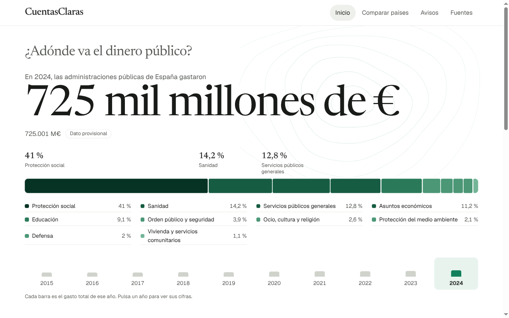
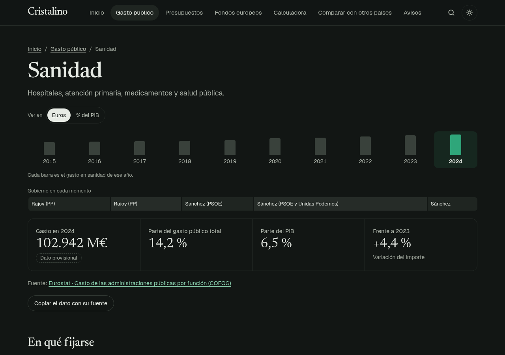
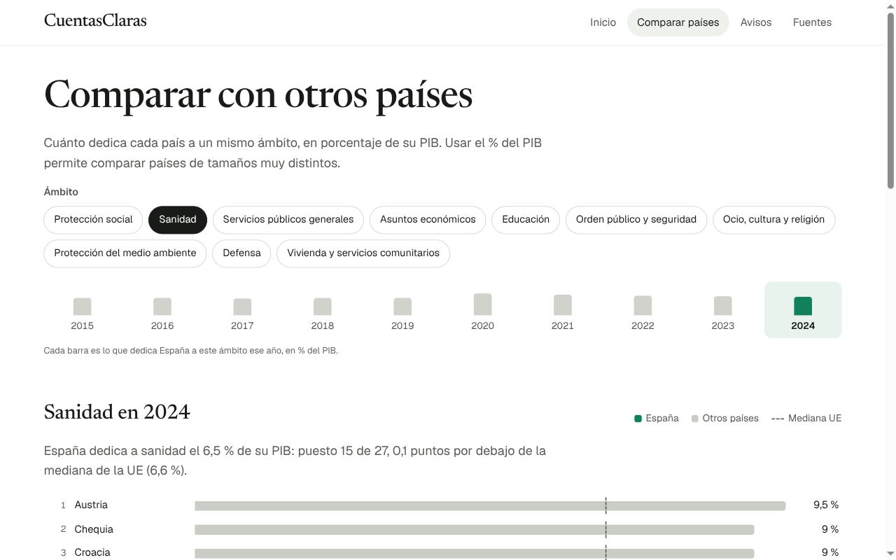

# CuentasClaras

**¿Adónde va el dinero público?** Un explorador del gasto público de España: cuánto se
gasta en cada ámbito, qué uso real se le da y avisos cuando gasto y uso no cuadran o
cuando España se aleja de la mediana europea.

Equipo **Leather and Lies** (Mario, Pedro y Dersu) · Hackatón 2Campus1Code, noviembre de 2026.



## Qué hace

- **Gasto por ámbito** (sanidad, educación, defensa…), de 2015 a 2024, con su evolución,
  sus subámbitos y en qué se va el dinero (personal, compras, inversión…).
- **Comparación entre países** en % del PIB: los 27 de la UE con su mediana y la posición
  de España; la API añade además EE. UU., Japón, Reino Unido, Corea del Sur y Australia.
- **Avisos**, de dos tipos: gasto que no se corresponde con el uso real (por ejemplo, la
  cuota de gasto en un modo de transporte frente a los viajeros que lo usan) y ámbitos en
  los que España se desvía de la mediana europea. Señalan dónde mirar; no acusan.
- **Presupuestos Generales del Estado** partida a partida (2015-2025), en la API.
- **Cada cifra lleva su fuente oficial** y su enlace. Los datos provisionales van marcados.

| Ficha de un ámbito | Comparar países | Avisos |
|---|---|---|
|  |  |  |

## Cómo arrancarlo

Hace falta Python 3.12 y Node 20 o posterior. Los datos ya vienen en el repositorio
(`data/dataset.json`), así que no hay que descargar nada.

```bash
# 1. Backend (http://localhost:8000/docs)
cd backend && python3 -m venv .venv && .venv/bin/pip install -r requirements.txt && .venv/bin/uvicorn main:app

# 2. Frontend, en otra terminal (http://localhost:5173)
cd frontend && npm install && VITE_API_URL=http://localhost:8000/api npm run dev

# 3. Tests del backend (opcional)
cd backend && .venv/bin/python -m pytest -q
```

Sin `VITE_API_URL`, el frontend llama a `http://localhost:8000/api`; con
`VITE_API_URL=mocks` funciona con datos de ejemplo, sin backend. Para regenerar los datos
desde las fuentes oficiales, ver [`data/README.md`](data/README.md).

## Cómo está hecho

```
fuentes oficiales ─► data/ (Python) ─► dataset.json ─► backend/ (FastAPI) ─► /api/* ─► frontend/ (React)
```

| Carpeta | Qué es | Responsable |
|---------|--------|-------------|
| [`data/`](data/README.md) | Descarga, valida y cruza los datos; escribe `dataset.json` | Mario |
| [`backend/`](backend/README.md) | API: cuotas, variaciones, posiciones y avisos. Sin base de datos | Pedro |
| [`frontend/`](frontend/README.md) | Web con React, Vite y Recharts | Dersu |
| [`docs/`](docs/) | [Arquitectura y decisiones](docs/ARCHITECTURE.md), [contrato de la API](docs/API_CONTRACT.md), [fuentes](docs/DATA_SOURCES.md) | |

## Fuentes de datos abiertos

| Fuente | Organismo | Qué aporta |
|--------|-----------|------------|
| [Gasto de las administraciones públicas por función (COFOG), `gov_10a_exp`](https://ec.europa.eu/eurostat/databrowser/view/gov_10a_exp/default/table) | Eurostat | Gasto por ámbito de los 27 países de la UE y desglose por tipo de gasto |
| [Alumnado matriculado por nivel y tipo de centro, `educ_uoe_enra01`](https://ec.europa.eu/eurostat/databrowser/view/educ_uoe_enra01/default/table) | Eurostat | Uso real en educación, para los avisos |
| [Presupuestos Generales del Estado, estado de gastos por programas](https://www.sepg.pap.hacienda.gob.es/Presup/PGE2023Ley/MaestroDocumentos/PGE-ROM/N_23_E_R_31.htm) | Ministerio de Hacienda (SEPG) | Presupuesto del Estado partida a partida |
| [Gasto por función (COFOG) y PIB, Table 11](https://data-explorer.oecd.org/vis?df[ds]=dsDisseminateFinalDMZ&df[id]=DSD_NASEC10%40DF_TABLE11&df[ag]=OECD.SDD.NAD) | OCDE | Comparación con países de fuera de la UE |
| [API de datos abiertos del BOE](https://www.boe.es/datosabiertos/) | Agencia Estatal BOE | Ley de presupuestos de cada año y nombramientos de cada Gobierno |
| [Presidentes del Gobierno](https://www.lamoncloa.gob.es/presidente/presidentes/Paginas/index.aspx) | La Moncloa | Partido y coalición de cada Gobierno |
| [Natural Earth, países 1:50m](https://www.naturalearthdata.com/downloads/50m-cultural-vectors/) | Natural Earth (dominio público) | Contornos de los países del mapa (no aporta cifras) |

Las llamadas exactas a cada fuente están en [`docs/DATA_SOURCES.md`](docs/DATA_SOURCES.md).

## Uso de IA

Descrito en [`AI_USAGE.md`](AI_USAGE.md).
